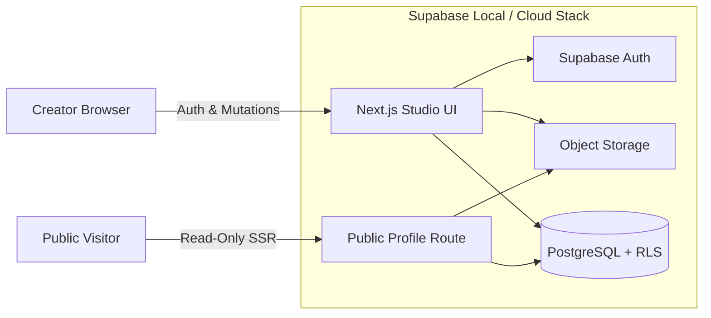

<div align="center">

# Snoozer.uk

**Own your corner of the internet.**  
*A privacy-first, open-source identity and publishing platform built to replace bloated, proprietary link-in-bio tools.*

[](https://nextjs.org)
[](https://typescriptlang.org)
[](https://supabase.com)
[](https://playwright.dev)
[](Dockerfile)
[](LICENSE)

[**Roadmap**](PROGRESS.md) · [**Architecture & Docs**](docs/) · [**Contributing**](CONTRIBUTING.md) · [**Security Policy**](SECURITY.md)

</div>

<br />

> **Development Status:** Active Pre-v1.0. Core identity flows, Studio draft/publish workflows, and RLS-backed database migrations are implemented and verified via automated CI/CD, unit tests, and Playwright E2E suites.

---

## 🎯 Why Snoozer.uk?

Most link-in-bio platforms lock basic customization behind subscriptions, inject third-party ad pixels, and harvest visitor analytics. **Snoozer.uk** provides a fast, auditable, self-hostable alternative that puts creators in complete control of their data.

| Feature | Proprietary Link-in-Bio | Snoozer.uk |
| :--- | :--- | :--- |
| **Data Ownership** | Locked in vendor silos | Self-hostable with portable Postgres schemas |
| **Visitor Privacy** | Ad pixels & tracking scripts | Zero telemetry or third-party trackers |
| **Publishing Flow** | Direct-to-live edits | Isolated Studio drafting with atomic publishing |
| **Extensibility** | Closed-source | Modular Next.js App Router & TypeScript codebase |

---

## 🏗 System Architecture

Snoozer.uk enforces a strict boundary between **authenticated creator mutations** (Studio) and **unauthenticated public reads** (Visitor profiles).



### Core Stack
* **Frontend & Routing:** Next.js (App Router), React, TypeScript (`strict: true`)
* **Backend & Persistence:** Supabase (PostgreSQL with Row-Level Security, Auth, Storage)
* **Quality Assurance:** Vitest (unit & integration), Playwright (full browser E2E), ESLint
* **Infrastructure:** Docker, Render Blueprint (`render.yaml`), GitHub Actions

---

## 🚀 Quick Start (Zero-Config Local Stack)

Snoozer.uk runs against a completely disposable local Supabase environment—no cloud account required to develop or run tests.

### Prerequisites
* **Node.js 24 LTS** & `npm`
* **Docker** (running locally for Supabase containers)

### 1. Clone & Install Dependencies
```bash
git clone https://github.com
cd snoozer-uk
npm ci
```

### 2. Boot Local Supabase Services
```bash
npx --yes supabase@3.1.0 start
```
*Spins up local PostgreSQL, GoTrue Auth, Storage buckets, and a local Inbucket email catcher.*

### 3. Configure Environment Variables
```bash
cp .env.example .env.local
npx --yes supabase@3.1.0 status
```
Copy the local `API URL`, `anon key`, and `service_role key` from the status output into `.env.local` *(never commit service credentials)*.

### 4. Start the Application
```bash
npm run dev
```
1. Visit `http://localhost:3000` and register an account.
2. Open the local email catcher (URL printed in `supabase status`) to verify your email.
3. Claim a handle in **Studio**, add links, sections, or media, and hit **Publish**.
4. Open your public handle in an incognito window to verify visitor access.

> **Clean Database Reset:** Run `npx --yes supabase@3.1.0 db reset` at any time to rebuild the database cleanly from declarative migrations in `supabase/`.

---

## 🧪 Verification & Quality Gates

Every pull request must pass static analysis, security audits, unit tests, and headless browser E2E verification:

```bash
# 1. Static Analysis & Dependency Audit
npm run lint
npm run typecheck
npm audit

# 2. Unit Tests & Production Build
npm test
npm run build

# 3. Playwright End-to-End Smoke Suite
npx playwright install chromium
npm run test:e2e
```

*To run provider-level E2E tests against your local stack, export the local Supabase variables and set `SNOOZER_TEST_LOCAL_SUPABASE=1` prior to building.*

---

## 📂 Repository Map

```text
snoozer-uk/
├── .github/          # CI/CD pipelines and issue/PR templates
├── docs/             # Architecture Decision Records (ADRs), threat model & guides
├── e2e/              # Playwright end-to-end browser specifications
├── scripts/          # Developer automation and environment helpers
├── src/              # Next.js App Router, Studio editor, and server actions
├── supabase/         # Declarative SQL migrations, seeds, and local config
├── tests/            # Vitest unit and integration test suites
├── Dockerfile        # Multi-stage production container image
└── render.yaml       # Infrastructure-as-Code deployment specification
```

---

## 🗺 Roadmap & Documentation

* **Project Roadmap:** Track v1.0 milestones and completed features in [`PROGRESS.md`](PROGRESS.md).
* **Architecture & Threat Model:** Review security boundaries and design decisions in [`docs/`](docs/).
* **Contributing:** See [`CONTRIBUTING.md`](CONTRIBUTING.md) for local workflow rules and PR standards.
* **Security Policy:** Report vulnerabilities responsibly via [`SECURITY.md`](SECURITY.md).

---

<div align="center">
<sub>Maintained in the open by <a href="https://github.com">@Truwty</a> · Contributions and feedback welcome.</sub>
</div>
